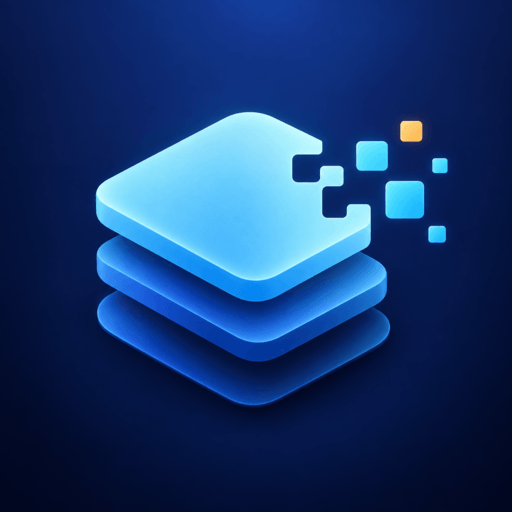

# MacCleaner



Native dev-cache cleaner for macOS. No dependencies, ~1 MB.


MacCleaner finds and measures the caches left behind by developer tools — Xcode, Gradle, Android Studio, npm, Cargo, Homebrew, Docker, VS Code, and more — and lets you delete what you choose. **73 categories** across 11 groups, including AI-assistant leftovers and build artifacts inside your own projects.

## Features

- **Scan-only by default** — analyzing never deletes anything
- **73 categories in 11 groups**: Xcode, JVM / Android, Node, other languages, code editors, Unity, AI tools, project artifacts, dev tools, browsers, system
- **Risk-based selection** — nothing is pre-selected; bulk-select by risk level with live totals
- **Expandable rows** — 22 categories break down by version, project, app, device, etc., with per-item size and last-modified date
- **Stale highlighting** — items untouched for 6+ months are flagged in amber
- **In-use detection** — a cache whose program is open (Xcode, a Gradle daemon, `npm install`, a browser…) is flagged and skipped at clean time
- **Safety first** — never touches anything outside your home directory, skips TCC-protected paths, moves to Trash by default, re-checks every path right before deleting it
- **Cleanup history** — every deleted, trashed or skipped path is logged to `~/Library/Logs/MacCleaner/operations.log`
- **Accurate measuring** — counts allocated blocks like `du`, deduplicates hard links, never double-counts a path
- **Localized in 43 languages**, follows your system language with English fallback

## Requirements

- macOS 13 or later
- Xcode 15+ / Swift 5.9+ (only to build from source)

## Installation

### Build from source

```bash
git clone https://github.com/jsoriase/MacCleaner.git
cd MacCleaner
./build.sh
```

This produces a universal (`arm64 + x86_64`) `MacCleaner.app` in the project root. To build for a single architecture, pass it as an argument:

```bash
./build.sh arm64    # Apple Silicon only
./build.sh x86_64   # Intel only
```

A single-architecture build compiles in about half the time and the binary is about half the size (~1 MB less). Memory use and speed are the same: macOS only loads the slice for the running Mac. Use the universal build for an app that has to run on both Apple Silicon and Intel Macs.

To install:

```bash
cp -R MacCleaner.app /Applications/
```

> The app is ad-hoc signed, so on first launch macOS will warn that it is not from an identified developer. Right-click > Open, or allow it in Settings > Privacy & Security.

## Usage

1. **Analyze.** Click Analyze to measure everything. Nothing is deleted.
2. **Select.** Nothing is selected on launch — every cleanup is an explicit choice.
   - Use the three toolbar buttons to bulk-select by risk level (`Safe`, `Rebuild`, `Caution`). They stack: `Safe` + `Rebuild` selects both.
   - Each button shows its own total, so you see the gain before deciding.
   - Or select individual rows, or hover a group header for `All` / `None`.
   - Selection is not remembered between launches.
3. **Clean.** A confirmation dialog shows exactly how much and what will be removed, with a separate warning for `Caution` items.

Other UI details:

- The header shows both reclaimable space and current free space (`6.5 GB free of 245 GB`).
- Expandable rows show each sub-item with size and relative last-modified date (`3 hours ago`, `3 months ago`).
- Right-click > **Show in Finder** opens a row's path — useful before deleting `Caution` items.
- Right-click > **Don't offer again** hides a row or a single sub-item for good. **File > Offer ignored items again** brings everything back.
- An **In use: Xcode** badge marks paths whose program is open. Close it and come back: the badge refreshes when the app regains focus.
- The cleanup report separates what was **skipped** (and why) from what **failed**, and shows how free space moved (`6.0 GB → 9.1 GB (+3.1 GB)`).
- **File > Cleanup history** (⌘Y) opens the operations log.

## What it cleans

| Group | Examples |
| ----- | -------- |
| Xcode | DerivedData (per project), Archives (per date), DeviceSupport (per iOS version), simulators (per device), unused simulator runtimes, parallel-testing clones, Organizer data |
| JVM / Android | Gradle caches (per version), wrapper dists, Android emulators (per AVD), system images (per API), JetBrains / Android Studio caches (per IDE version) |
| Node | npm, pnpm store, Yarn, Bun / Deno caches, Corepack, node-gyp, TypeScript / ESLint / Prettier / Vite / Prisma caches, Expo, Electron app caches (per app), Playwright / Puppeteer browsers |
| Languages | Cargo, Go, Python, Ruby, Maven, Terraform, Bazel, Zig, Ruff, mypy, etc. |
| Code editors | VS Code / Cursor / Windsurf / VSCodium cached VSIX, code cache and logs; extension versions the editor marked obsolete |
| Unity | Package Manager cache, Asset Store downloads (per publisher), Editor build and GI caches, Hub updates and templates, Unity logs, and the `Library`, `Temp` and `obj` folders of your Unity projects |
| AI tools | Agent worktrees (per branch), assistant VMs, downloaded models, abandoned Codex runtimes |
| Project artifacts | `node_modules`, `Pods`, `target`, `build`, `.venv` found under `~/Projects`, `~/Code`, `~/dev`, `~/Developer`, `~/src`, `~/GitHub`, `~/Workspace`, `~/repos`, `~/Sites` |
| Dev tools | Homebrew, Docker, Docker Buildx cache |
| Browsers | Chromium-family cache, service workers, site storage, history, cookies |
| System | User caches, logs, saved app state, old installers, Trash |

### Risk levels

Every category has one, with a matching bulk-select button:

- **Safe** — regenerates on its own, no side effects.
- **Rebuild** — safe, but the next build / launch will be slower.
- **Caution** — requires re-downloading or loses useful data (Xcode Archives, Maven repo, project dependencies, Trash, …).

Hovering a row's badge explains *why* it has that level.

### Special cases

**Project artifacts** live where your code lives, not at a fixed path. Two rows (`Project dependencies`, `Build outputs`) sweep your code folders up to 8 levels deep, skipping hidden directories (except artifacts like `.build`, `.venv`, `.next`) and never descending into a match (so a `build` inside `node_modules` isn't counted twice). Home directory only — external drives and `/Volumes` are excluded.

A third row (`Unity project caches`) does the same for the `Library`, `Temp` and `obj` folders of Unity projects. Those names are too common to take on their own, so they are only collected when `ProjectSettings/ProjectVersion.txt` sits beside them: a Swift `Library/` or a .NET `obj/` is left alone. Nothing inside a Unity `Library` is offered by the other two rows.

A folder name alone isn't enough, because `build`, `target` and `vendor` are also ordinary names:

- Artifacts written in the last 7 days are left out of bulk selection (risk buttons, group **All**, the row checkbox) — one of them is probably the project you have open. Tick them by hand if you mean it. Their age shows in blue.
- Ambiguous names need proof that a tool made them: `build` needs a Gradle, CMake, Flutter, Node or Python project next to it, `target` a `Cargo.toml` / `pom.xml` / `build.sbt`, `vendor` Composer's `autoload.php` or Go's `modules.txt` (so a Rails `vendor/` is left alone), `venv` / `.venv` a `pyvenv.cfg`, `Pods` a `Podfile`, `.build` a `Package.swift`.
- Anything tracked by git is never offered, whatever its name (VS Code's `build/` folder is source code). git is asked in one batch per repository; if it isn't installed, only the first check applies.

**Simulators, simulator runtimes and Docker are delegated to their own tools**, not `rm`:

- Simulators: `xcrun simctl delete <UDID>`
- Simulator runtimes: `xcrun simctl runtime delete <id>`. Only *orphans* are offered — ready, deletable, with no simulator using them and no second image for the same runtime. They live outside your home (7–10 GB each), which is why only `simctl` touches them. Right before deleting, the list is fetched again and a runtime that gained a simulator is skipped.
- Docker: `docker system prune --force` (without `--all` / `--volumes`, so tagged images and database volumes are preserved). The row shows what that command would actually free — stopped containers, dangling images and build cache not shared with an image, as reported by `docker system df` — not the size of `Docker.raw`, which also holds everything prune keeps. With Docker closed it shows nothing, since prune couldn't run. After pruning, the app waits up to 20 s for `Docker.raw` to give the space back to the Mac (the VM releases freed blocks in batches, several seconds later) and counts only what both Docker and the disk confirm.

For these rows space is re-measured after cleanup, and Trash does not apply. The in-use check doesn't apply either: the tool guards its own data (`simctl` refuses to delete a booted simulator, and `docker prune` needs Docker running).

**Leftover versions** are picked one by one rather than by folder name: of all installed editor extensions, only those the editor listed in `extensions/.obsolete` after an update; of the Codex runtimes, only half-finished downloads — the complete runtime Codex uses is never offered.

**Browsers:** Chromium browsers (Chrome, Brave, Edge, Chromium, Vivaldi) share a profile layout and are handled per profile. Almost all reclaimable space is cache (~97%); history and cookies are included for privacy, not space. Firefox derivatives share the cache / storage rows, but history is excluded (Firefox stores history and bookmarks in a single `places.sqlite`). Safari is not included — it requires Full Disk Access, which this app deliberately does not request.

## Safety

Layers, all covered by tests:

1. Nothing outside `$HOME` is ever touched — no `/`, no `/System`, no other volumes. Only absolute paths without control characters are accepted.
2. Top-level home folders (`Library`, `Documents`, `Desktop`, `Downloads`, `Pictures`, …) are protected.
3. TCC-protected paths (`com.apple.Music`, `com.apple.Photos`, `MobileSync`, …) are ignored entirely — even reading them would trigger a permission prompt and freeze the scan. Coding assistants' conversation history (`~/.codex/sessions`, `~/.claude/projects`) is protected too: it weighs gigabytes, but it's data, not cache.
4. Other apps' sandbox containers (`~/Library/Containers`, `~/Library/Group Containers`) are never entered: since macOS Sonoma, doing so asks "would like to access data from other apps" on every scan. Sandboxed apps' own caches are therefore not included. The one exception is Docker, which isn't sandboxed and only keeps its data under that folder.
5. Symlinks in the middle of a path are resolved and the real location is checked again. A `~/.npm` pointing into `~/Documents` is refused. The resolved path can only take permission away, never grant it: a cache moved to an external disk (`/Volumes/…`) can still be cleaned, but never the volume root, the system, or another protected home folder. A symlink as the last component is removed itself, not what it points to.
6. **Is it in use?** Each path has an owner — Xcode, Simulator (including a booted device), a Gradle or Kotlin daemon, npm / pnpm / Yarn, Cargo, Go, the browsers, VS Code, Cursor, Claude Code, Codex, Unity, Unity Hub, … — and any app that is open owns its own `~/Library/Caches/<id or name>` and `~/Library/Application Support/<name>`. An open Unity editor, including a `-batchmode` build, owns the `Library`, `Temp` and `obj` of every Unity project, because there is no reliable way to tell which one it has open. Processes are listed with `libproc` (no `ps`), scripts are recognized by the script and not the interpreter (`node …/npm` is npm). If the process list can't be read, owned paths are skipped: unknown means no.
7. **Re-checked right before deleting**, not just at scan time: ownership again, and the path must still be the same object (device + inode) that was measured — a folder recreated or swapped for a symlink in between is skipped. Project artifacts also must not have been written to since the scan started, nor added to git.
8. `Tests/MacCleanerTests/Fixtures/dangerous_paths.txt` lists 96 adversarial paths (system roots, home folders, `..` escapes, relative paths, protected data) that the final check must reject, every one.

Every cleanup is recorded in `~/Library/Logs/MacCleaner/operations.log`, one tab-separated line per path: timestamp, action (`TRASH`, `DELETE`, `TOOL`), status (`OK`, `PARTIAL`, `FAILED`, `SKIPPED`), bytes, path and detail. It rotates to `.1` at 5 MB. Scanning writes nothing.

Deletion moves to Trash by default. Three rows always delete for real: the two tool-delegated ones, and the Trash row itself, since moving the Trash into the Trash frees nothing. The Trash row also runs first, so it never empties what other rows just moved there. Freed space is reported as "Moved to Trash", not "Freed", until you empty it.

## How it works

**Performance.** Written in Swift with direct `fts(3)` / `glob(3)` traversal instead of `FileManager.enumerator` — pure C, no intermediate objects, flat memory use:

| State | Memory |
| ----- | ------ |
| Idle | ~38 MB |
| Peak scanning 49 GB / ~500k files | ~75 MB |

A comparable Electron cleaner uses ~300–400 MB.

**Measuring.** Counts allocated blocks like `du`, not logical file size (a sparse `Docker.raw` reporting 228 GB may only occupy 15 GB). Files with multiple hard links (e.g. pnpm stores) are counted once. Overlapping patterns are resolved so no path is counted in two rows, and the header total never over-promises.

Freed space may lag behind deleted bytes for reasons outside the app's control: APFS clones sharing blocks, Trash, local Time Machine snapshots, and APFS returning blocks in the background. The header re-reads free space after cleaning (until two consecutive reads agree) and whenever the app returns to the foreground.

Free space uses Finder's number (`volumeAvailableCapacityForImportantUsage`), including purgeable space — correct for "will I run out of disk?", but it won't rise 1:1 with deletions since some caches already counted as available.

## Localization

The UI follows the system language (English fallback) and covers 43 locales: Europe's primary languages plus Spain's co-official languages and the world's most spoken languages (`sq`, `ar`, `be`, `bg`, `bs`, `ca`, `cs`, `da`, `de`, `el`, `en`, `es`, `et`, `eu`, `fi`, `fr`, `ga`, `gl`, `hi`, `hr`, `hu`, `is`, `it`, `ja`, `lb`, `lt`, `lv`, `mk`, `mt`, `nb`, `nl`, `pl`, `pt-BR`, `pt-PT`, `ro`, `ru`, `sk`, `sl`, `sr`, `sv`, `tr`, `uk`, `zh-Hans`).

Strings live in `Resources/Localizations/<lang>.lproj/Localizable.strings` and category names/descriptions are derived from catalog IDs, so they can't drift out of sync.

To try a language without changing the system one:

```bash
open MacCleaner.app --args -AppleLanguages "(ja)"
```

> Translations were produced by a language model, not native speakers. Romance and Germanic languages are solid; Maltese, Luxembourgish, Irish, Basque, and Albanian deserve review before wide distribution.

## Development

```
Sources/MacCleaner/
  App/MacCleanerApp.swift    entry point
  Core/FileSystem.swift      glob, fts, deletion, protected paths
  Core/Catalog.swift         the 73 categories and their paths
  Core/Engine.swift          parallel analysis, pre-delete checks, cleaning, reclaim tracking
  Core/Occupancy.swift       which program uses which path, process listing
  Core/SimRuntimes.swift     orphan simulator runtimes via simctl
  Core/OperationLog.swift    cleanup history
  Core/Tools.swift           simctl / docker / git execution
  UI/ContentView.swift       main window
  UI/Components.swift        rows, headers, badges
```

Run tests (no dependencies, no network):

```bash
swift test
```

To add a category, add one more `Target` in `Catalog.swift` — risk level, consequence, and path patterns are required and validated by tests.
